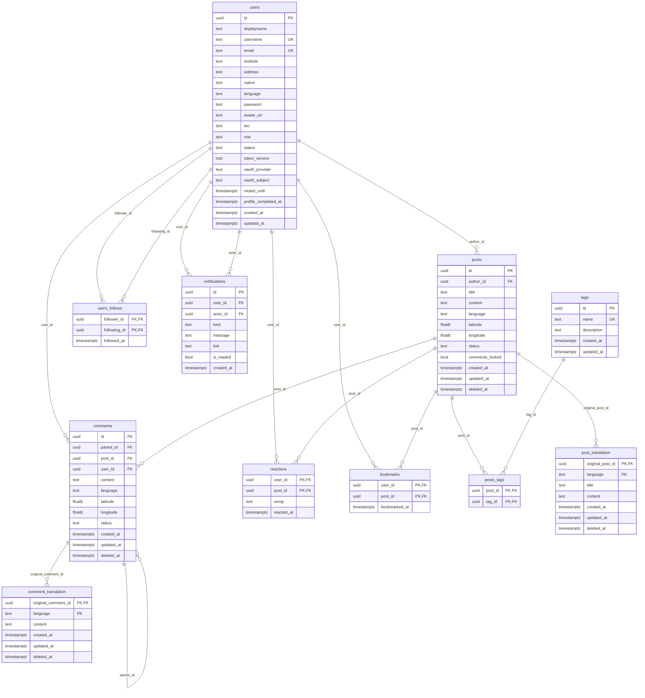

# Quản lý phiên bản lược đồ cơ sở dữ liệu (`migrations/`)

Thư mục `migrations/` lưu trữ toàn bộ lịch sử thay đổi cấu trúc cơ sở dữ liệu PostgreSQL của hệ thống Etsubi, được quản lý tuần tự thông qua công cụ `diesel_cli`.

## Cấu trúc các thành phần

Mỗi bản cập nhật lược đồ được đóng gói thành một thư mục riêng biệt đặt tên theo định dạng `<YYYY-MM-DD-HHMMSS>_<tên_migration>/` và bao gồm hai tệp SQL:

```text
migrations/
├── <timestamp>_<ten_migration>/
│   ├── up.sql    # Câu lệnh DDL khởi tạo hoặc chỉnh sửa bảng, chỉ mục, khóa ngoại và ràng buộc dữ liệu
│   └── down.sql  # Câu lệnh DDL hoàn tác toàn bộ thay đổi đã thực hiện trong tệp up.sql
└── ...

```

## Schema hiện tại



## Tính năng và đối tượng lược đồ quản lý

* **Khởi tạo cấu trúc bảng cốt lõi**: Định nghĩa các bảng dữ liệu chính của diễn đàn bao gồm `users`, `posts`, `comments`, `tags`, `post_tags`, `reactions`, `bookmarks`, `follows`, `notifications` và bảng lưu trữ bản dịch `translations`.
* **Ràng buộc toàn vẹn dữ liệu**: Thiết lập khóa chính dạng `UUID`, khóa ngoại liên kết giữa các thực thể kèm quy tắc xóa tầng (`ON DELETE CASCADE`), ràng buộc duy nhất (`UNIQUE`) cho email, tên đăng nhập, lượt theo dõi và lượt lưu bài viết.
* **Chỉ mục phục vụ truy vấn**: Tạo các chỉ mục (`INDEX`) trên các cột thường xuyên dùng để lọc và sắp xếp như định danh tác giả, thời gian tạo, trạng thái xóa mềm (`deleted_at`), mã bài viết và người nhận thông báo.
* **Cơ chế hoàn tác an toàn**: Tệp `down.sql` cho phép quay lui lược đồ về trạng thái trước đó theo thứ tự ngược lại khi cần kiểm thử hoặc khôi phục cấu trúc bảng.

## Tính chất kỹ thuật

* **Theo dõi trạng thái tự động**: `diesel_cli` duy trì bảng hệ thống `__diesel_schema_migrations` trong PostgreSQL để ghi nhận các phiên bản đã thực thi, đảm bảo mỗi tệp `up.sql` chỉ chạy một lần duy nhất trên mỗi môi trường.
* **Đồng bộ hóa mã nguồn Rust**: Khi chạy lệnh `diesel migration run` hoặc `diesel migration revert`, công cụ tự động cập nhật lại tệp `src/infrastructure/database/schema.rs` để trình biên dịch Rust kiểm tra tính khớp nối kiểu dữ liệu giữa câu lệnh truy vấn và cấu trúc bảng thực tế.
* **Thực thi tự động khi triển khai**: Trong môi trường container, tệp `docker/entrypoint.sh` tự động gọi `diesel migration run` ngay sau khi PostgreSQL sẵn sàng kết nối và trước khi tiến trình máy chủ HTTP khởi động.
