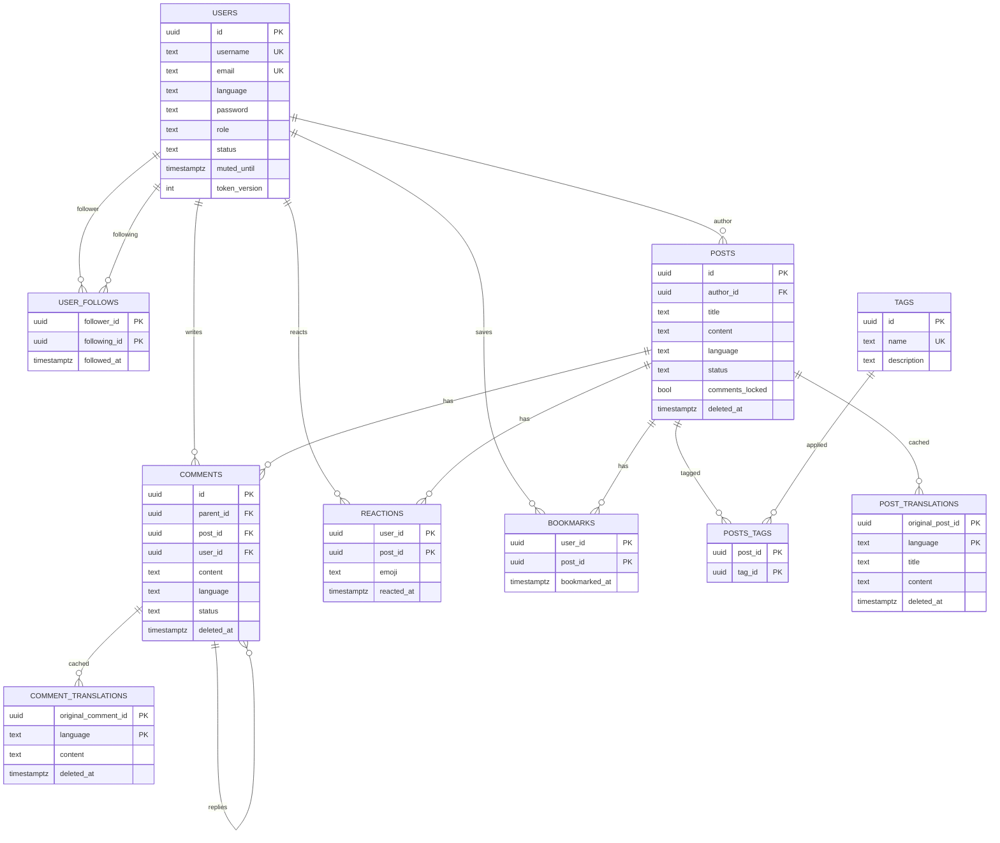

# Entities

Etsubi dùng PostgreSQL 15 với 10 bảng nghiệp vụ, truy cập qua Diesel ORM.

## Nhóm bảng

| Nhóm | Bảng | Ghi chú |
|---|---|---|
| Người dùng | `users`, `users_follows` | Follow là N:M tự thân, có `CHECK (follower_id <> following_id)` |
| Nội dung | `posts`, `comments` | Soft-delete bằng `deleted_at`; comment reply qua `parent_id` |
| Tương tác | `reactions`, `bookmarks`, `tags`, `posts_tags` | Reaction và bookmark là N:M với PK tổng hợp, mỗi cặp user-post chỉ một bản ghi |
| Cache dịch | `post_translation`, `comment_translation` | PK `(entity_id, language)`; `deleted_at` vô hiệu cache khi nội dung gốc đổi |

## Quy ước

- `id` là UUID (`gen_random_uuid()`); thời gian là `TIMESTAMPTZ` UTC.
- `language` chỉ nhận `vi`, `en`, `ja`.
- `users` hard-delete, CASCADE xuống mọi bảng con. `posts`/`comments` và 2 bảng translation soft-delete.
- `users.token_version` dùng để invalid JWT cũ khi logout / đổi mật khẩu.
