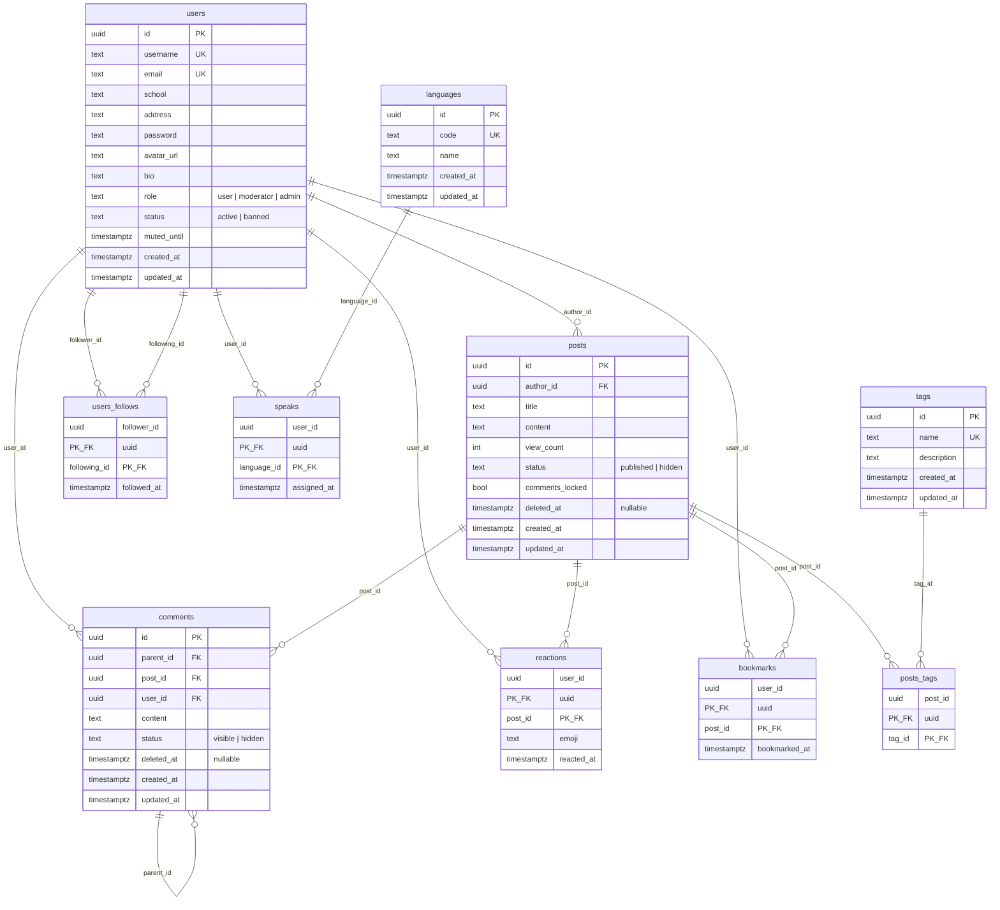

# Entities

## ER Diagram

## Bảng chi tiết

### users

Người dùng hệ thống.

| Trường | Kiểu | Ghi chú |
|--------|------|---------|
| id | UUID | Primary key |
| username | text | Unique, tối thiểu 3 ký tự |
| email | text | Unique, dùng để đăng nhập |
| school | text? | |
| address | text? | |
| password | text | Hash Argon2 |
| avatar_url | text? | |
| bio | text? | |
| role | text | `user`, `moderator`, `admin` |
| status | text | `active`, `banned` |
| muted_until | timestamptz? | Hết hạn mute; middleware chặn write nếu `> now()` |
| created_at | timestamptz | |
| updated_at | timestamptz | |

### posts

Bài viết.

| Trường | Kiểu | Ghi chú |
|--------|------|---------|
| id | UUID | |
| author_id | UUID | FK → users |
| title | text | Tối đa 255 ký tự |
| content | text? | Tối đa 100,000 ký tự |
| view_count | int | Default 0 |
| status | text | `published`, `hidden` |
| comments_locked | bool | Khoá bình luận |
| deleted_at | timestamptz? | Xoá mềm |
| created_at | timestamptz | |
| updated_at | timestamptz | |

### comments

Bình luận, hỗ trợ reply.

| Trường | Kiểu | Ghi chú |
|--------|------|---------|
| id | UUID | |
| parent_id | UUID? | FK → comments (reply) |
| post_id | UUID | FK → posts |
| user_id | UUID | FK → users |
| content | text | Tối đa 10,000 ký tự |
| status | text | `visible`, `hidden` |
| deleted_at | timestamptz? | Xoá mềm |
| created_at | timestamptz | |
| updated_at | timestamptz | |

### tags

Nhãn phân loại bài viết.

| Trường | Kiểu | Ghi chú |
|--------|------|---------|
| id | UUID | |
| name | text | Unique |
| description | text? | |
| created_at | timestamptz | |
| updated_at | timestamptz | |

Seed sẵn 5 tag: `general`, `question`, `discussion`, `announcement`, `showcase`
(migration `2026-10-24-105248-0000_seed_tags`).

### posts_tags

Quan hệ N-N giữa `posts` và `tags`.

| Trường | Kiểu |
|--------|------|
| post_id | UUID, FK → posts |
| tag_id | UUID, FK → tags |

Primary key: `(post_id, tag_id)`.

### reactions

User thả emoji vào post.

| Trường | Kiểu | Ghi chú |
|--------|------|---------|
| user_id | UUID | FK → users |
| post_id | UUID | FK → posts |
| emoji | text | Trim, tối đa 32 chars (validate ở service) |
| reacted_at | timestamptz | Cập nhật lại mỗi lần upsert |

Primary key: `(user_id, post_id)` — mỗi user chỉ có 1 reaction / post.
POST là **upsert** (gửi cùng emoji = idempotent, gửi emoji khác = đổi).

### bookmarks

User lưu post.

| Trường | Kiểu |
|--------|------|
| user_id | UUID, FK → users |
| post_id | UUID, FK → posts |
| bookmarked_at | timestamptz |

Primary key: `(user_id, post_id)`.

### users_follows

Quan hệ follow giữa users.

| Trường | Kiểu |
|--------|------|
| follower_id | UUID, FK → users |
| following_id | UUID, FK → users |
| followed_at | timestamptz |

Primary key: `(follower_id, following_id)`. Có CHECK `follower_id <> following_id`.

### languages

Danh mục ngôn ngữ (bảng tra cứu).

| Trường | Kiểu | Ghi chú |
|--------|------|---------|
| id | UUID | |
| code | text | Unique, ISO 639-1 (2 ký tự) |
| name | text | Tên hiển thị |
| created_at | timestamptz | |
| updated_at | timestamptz | |

Seed sẵn 14 ngôn ngữ: `en`, `ja`, `vi`, `zh`, `ko`, `fr`, `de`, `es`, `pt`,
`it`, `ru`, `ar`, `th`, `id` (migration `2026-10-26-162821-0000_seed_languages`).

### speaks

Quan hệ N-N giữa `users` và `languages` — user nói được ngôn ngữ nào.

| Trường | Kiểu |
|--------|------|
| user_id | UUID, FK → users |
| language_id | UUID, FK → languages |
| assigned_at | timestamptz |

Primary key: `(user_id, language_id)`.
