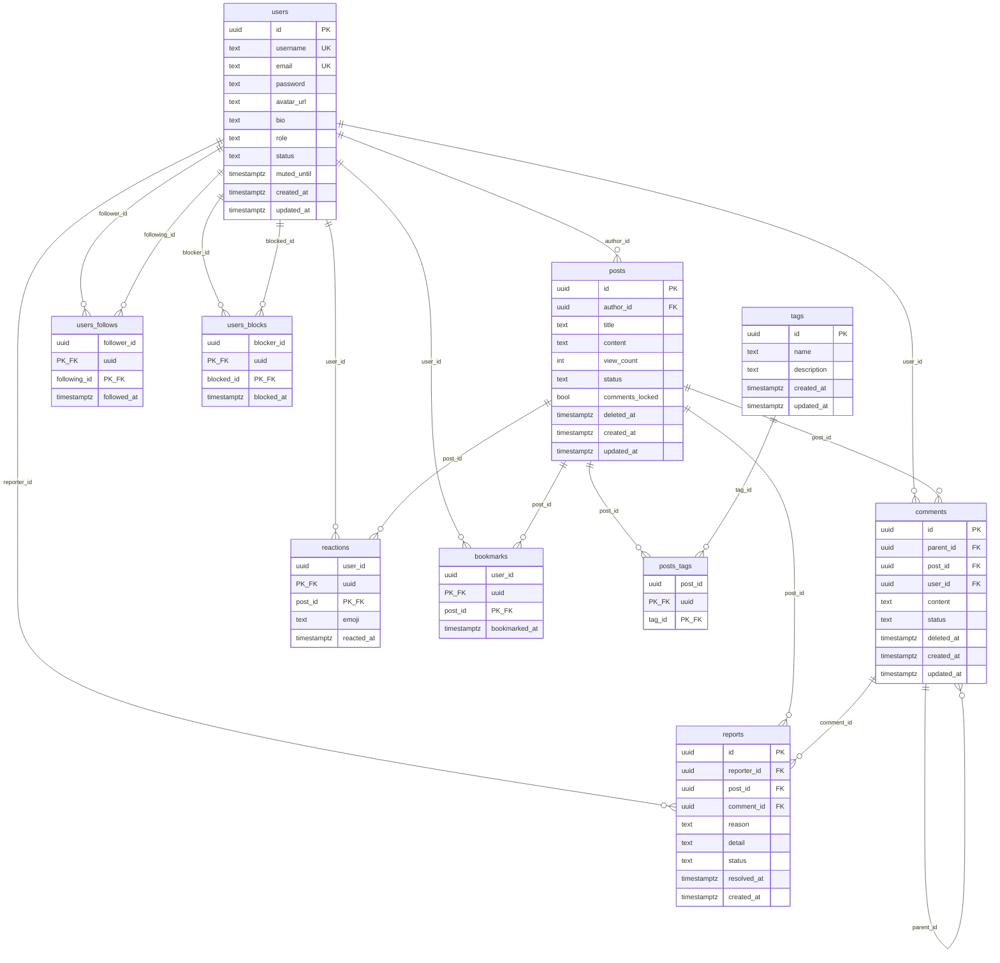

# Entities

## ER Diagram

## Bảng chi tiết

### users

Người dùng hệ thống.

| Trường | Kiểu | Ghi chú |
|--------|------|---------|
| id | UUID | Primary key |
| username | text | Unique, tối thiểu 3 ký tự |
| email | text | Unique, bất biến sau khi tạo |
| password | text | Hash Argon2 |
| avatar_url | text? | |
| bio | text? | |
| role | text | `user`, `moderator`, `admin` |
| status | text | `pending`, `active`, `banned` |
| muted_until | timestamptz? | Hết hạn mute |
| created_at | timestamptz | |
| updated_at | timestamptz | |

### posts

Bài viết.

| Trường | Kiểu | Ghi chú |
|--------|------|---------|
| id | UUID | |
| author_id | UUID | FK → users |
| title | text | Tối đa 255 ký tự |
| content | text? | Tối đa 100,000 ký tự |
| view_count | int | Default 0 |
| status | text | `published`, `hidden` |
| comments_locked | bool | Khoá bình luận |
| deleted_at | timestamptz? | Xoá mềm |
| created_at | timestamptz | |
| updated_at | timestamptz | |

### comments

Bình luận, hỗ trợ reply.

| Trường | Kiểu | Ghi chú |
|--------|------|---------|
| id | UUID | |
| parent_id | UUID? | FK → comments (reply) |
| post_id | UUID | FK → posts |
| user_id | UUID | FK → users |
| content | text | Tối đa 10,000 ký tự |
| status | text | `visible`, `hidden` |
| deleted_at | timestamptz? | Xoá mềm |
| created_at | timestamptz | |
| updated_at | timestamptz | |

### tags

Nhãn phân loại bài viết.

| Trường | Kiểu |
|--------|------|
| id | UUID |
| name | text |
| description | text? |
| created_at | timestamptz |
| updated_at | timestamptz |

### posts_tags

Quan hệ N-N giữa `posts` và `tags`.

| Trường | Kiểu |
|--------|------|
| post_id | UUID, FK → posts |
| tag_id | UUID, FK → tags |

Primary key: `(post_id, tag_id)`.

### reactions

User thả emoji vào post.

| Trường | Kiểu | Ghi chú |
|--------|------|---------|
| user_id | UUID | FK → users |
| post_id | UUID | FK → posts |
| emoji | text | |
| reacted_at | timestamptz | |

Primary key: `(user_id, post_id)` — mỗi user chỉ có 1 reaction / post.

### bookmarks

User lưu post.

| Trường | Kiểu |
|--------|------|
| user_id | UUID, FK → users |
| post_id | UUID, FK → posts |
| bookmarked_at | timestamptz |

Primary key: `(user_id, post_id)`.

### users_follows

Quan hệ follow giữa users.

| Trường | Kiểu |
|--------|------|
| follower_id | UUID, FK → users |
| following_id | UUID, FK → users |
| followed_at | timestamptz |

Primary key: `(follower_id, following_id)`. Có CHECK `follower_id <> following_id`.

### users_blocks

Quan hệ block giữa users.

| Trường | Kiểu |
|--------|------|
| blocker_id | UUID, FK → users |
| blocked_id | UUID, FK → users |
| blocked_at | timestamptz |

Primary key: `(blocker_id, blocked_id)`. Có CHECK `blocker_id <> blocked_id`.

### reports

Báo cáo vi phạm.

| Trường | Kiểu | Ghi chú |
|--------|------|---------|
| id | UUID | |
| reporter_id | UUID | FK → users |
| post_id | UUID? | FK → posts |
| comment_id | UUID? | FK → comments |
| reason | text | |
| detail | text? | |
| status | text | `pending`, `resolved`, `rejected` |
| resolved_at | timestamptz? | |
| created_at | timestamptz | |

CHECK constraint: chỉ một trong `post_id` hoặc `comment_id` là non-null.

## Trạng thái implement

Các bảng sau **đã có schema DB** nhưng **chưa có API**: `tags`, `posts_tags`, `reactions`, `bookmarks`, `users_follows`, `users_blocks`, `reports`.
