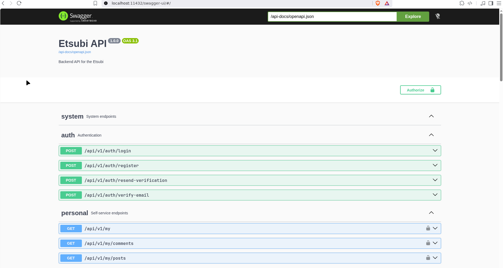

Ở thư mục root ta sẽ thấy file `.env.example` (do `.env` bị ignore), điều đầu tiên cần làm là tạo file `.env` mới và điền vào các field y như bên trong `.env.example`. 

Hiện tại thì ta đang cho `.env.example` = `.env` nên ta có thể copy y nguyên với một chút chỉnh sửa ở phần email provider. Khi đưa vào deployment thì ta sẽ sửa lại file `.env` và docker sau. 

Kế tiếp ta chạy lệnh:
```bash
docker compose --profile full up -d --build
```

Lập tức docker sẽ tải các gói phụ thuộc về để chạy. (Lưu ý cẩn thận bị chiếm port)

Sau khi thành công thì ta mở [link](http://localhost:21432/swagger-ui/) để truy cập openapi để có thể kiểm tra các API route có thể dùng được.



> Lưu ý là các hướng dẫn trên chỉ chạy E2E, ở đây ta không chạy riêng từng cái. 

Trong file docker-compose.yml và Dockerfile của mã nguồn, ta sẽ thấy có thiết lập cho DB và BE, song việc chạy thủ công có thể khiến cho hai tiến trình cùng ghi vào DB đồng thời gây khó khăn cho debug nên sẽ không được đề cập đến.
