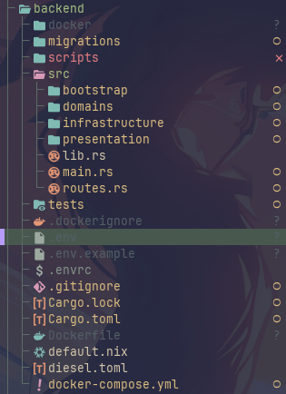
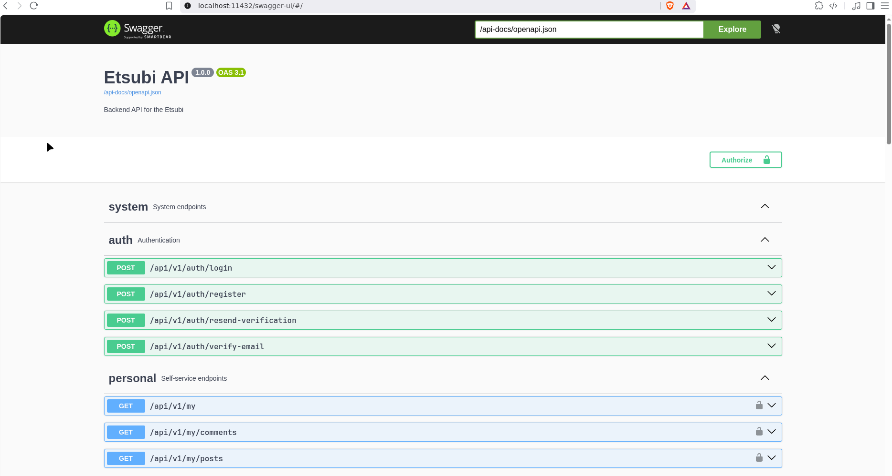

Đi vào thư mục backend ta sẽ thấy file `.env.example` (do `.env` bị ignore), điều đầu tiên cần làm là tạo file `.env` mới và điền vào các field y như bên trong `.env.example`. 



Hiện tại thì ta đang cho `.env.example` = `.env` nên ta có thể copy y nguyên với một chút chỉnh sửa ở phần email provider. Khi đưa vào deployment thì ta sẽ sửa lại file `.env` và docker sau. 

Kế tiếp ta chạy lệnh:
```bash
docker-compose up -d
```

Lập tức docker sẽ tải các gói phụ thuộc về để chạy. (Lưu ý cẩn thận bị chiếm port)

Sau khi thành công thì ta mở [link](http://localhost:11432/swagger-ui/#/) để truy cập openapi để có thể kiểm tra các API route có thể dùng được.



Tag, Report và email sẽ được bổ sung sau. Hiện tại thì đã test email verification thành công ở console nhưng chưa kiểm tra được có hoạt động ở deployment hay không.
