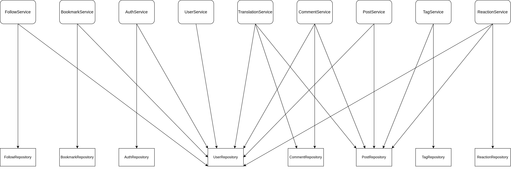
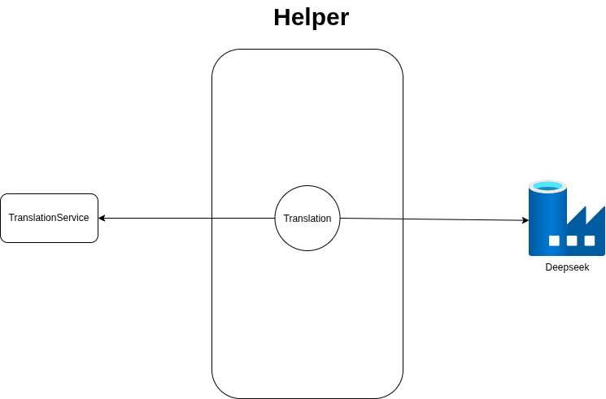

## Mối quan hệ giữa Service và các Repository.

## Các Service được gọi ra bên ngoài

Service sẽ thông qua các helper bên dưới infrastructure để gọi đến bên cung cấp dịch vụ.

Hiện tại thì chưa có email với Oauth2 do chưa có đủ tài nguyên, sẽ làm sau.

## Quy tắc khi gọi các service

Không xây thêm tầng application do quy mô chưa đủ lớn, mọi logic sau khi gọi service sẽ được xử lý tại handler.

